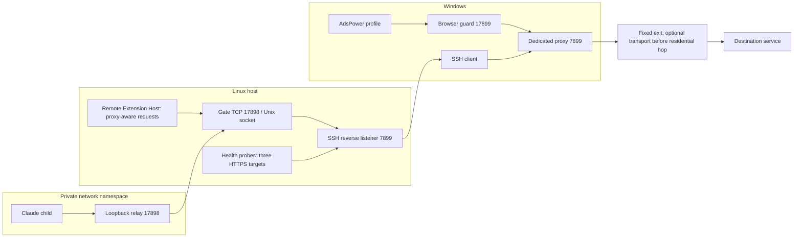

# 架构、判定条件与状态机

## 1. 三个执行位置

| 标识 | 位置 | 负责什么 |
| --- | --- | --- |
| W | Windows 工作站 | 专用代理入口、浏览器守卫与托盘连接管理器、SSH 客户端、本地编辑器/浏览器 |
| R | Linux 宿主 | SSH 反向转发的监听、gate、systemd 用户服务、Remote Extension Host |
| N | Linux 私有网络 namespace | 经 wrapper 启动的 Claude 及子进程、内部 loopback 代理中继 |

同一个 `127.0.0.1:端口` 在 W、R、N 中不是同一 socket。SSH 是把 R 上的指定监听转回 W；Unix socket 挂载和 PID1 中继则把 N 的代理请求送到 R。

## 2. 数据路径与探测路径

图中的箭头表示请求方向。SSH 的加密连接由 W 的客户端主动建立到 R 的 sshd；反向转发的数据请求则从 R 的监听返回 W。Windows guard 和连接管理器源码已收录在 windows/manager；完整交付记录见 [Windows 软件](windows.md)。

gate 的健康探测直接经过 R:7899，不经过它自己控制的 17898，所以 blocked 时仍能探测和恢复。N 中的应用只拿到 gate 中继，不直接获得 R:7899 的 TCP 网络。

## 3. 端口与 socket 的契约

| 位置 | 地址 | 创建者 | 消费者/用途 |
| --- | --- | --- | --- |
| W | `127.0.0.1:7899` | 使用者的代理核心 | 专用固定出口入口；guard 与 SSH 的上游 |
| W | `127.0.0.1:17899` | Windows Node guard | AdsPower profile；HTTP CONNECT |
| R | `127.0.0.1:7899` | W 发起的 SSH RemoteForward | Linux gate 唯一上游 |
| R | `127.0.0.1:17898` | Linux gate | 宿主中遵守代理设置的请求 |
| R | `/run/user/<UID>/claude-ip-gate/proxy.sock` | Linux gate | 权限 0600，挂给 N 中的中继 |
| N | `127.0.0.1:17898` | `claude-net-pid1.py` | Claude 子进程的 HTTP 代理 |
| N | `127.0.0.1:7898` | 同一 PID1 中继 | 兼容入口，同样送往 gate，不是第二个公网出口 |

`7897` 是原安装环境的通用/Git 代理约定，不是核心链路必需端口。R:17898 由 gate 管理，不应通过 SSH 再创建同名监听。loopback TCP 不等于用户私有：同一 Linux 宿主的其他用户可能访问 R:17898；Unix socket 才有这里的用户文件权限限制。

## 4. 单轮检查如何判定

设配置的预期公网 IP、国家、Anthropic POP 分别为 I、C、P。`libexec/claude-ip-gate` 的 `perform_checks()` 并行检查下表三项；三项全部通过才构成一次完整成功：

| 函数/目标 | 必须成立 | 不作为本项判定的内容 |
| --- | --- | --- |
| `probe_ipify()` → `https://api.ipify.org` | curl 成功，返回 IP = I | 供应商代理主机地址可能不等于 I |
| `probe_cloudflare()` → `https://www.cloudflare.com/cdn-cgi/trace` | curl 成功，`ip` = I，`loc` = C | 此站自己的 `colo` 只记录 |
| `probe_anthropic()` → `https://api.anthropic.com/` | curl 成功、有非 000 HTTP 状态和 CF-Ray，CF-Ray POP = P | 根路径 401/404 可表示边缘可达，不能证明模型权限 |

curl 明确使用唯一上游 `http://127.0.0.1:7899`，关闭 curlrc、清空 no-proxy 影响并限定 HTTPS。这里不是浏览器测试，也没有提交账号认证。`claude.ai` trace 的 POP、Cloudflare 官网 POP 与 API POP 不应互换，参数取得方法见 [代理与 SSH](proxy-and-ssh.md)。

这证明三个采样目的地在该轮满足条件。要把采样用于保护其他请求，还需要上游固定出站且不按目标改换节点。gate 本身不检查每条转发流量最终抵达的公网 IP，也不实现目的地域名白名单。

## 5. 状态和转发行为

| 状态/事件 | TCP/UDS 监听 | 既有转发 | 原始代理新连接 | guard 的新启动验收 |
| --- | --- | --- | --- | --- |
| daemon 刚启动，尚未完整成功 | 关闭 | 无 | 拒绝 | 不通过 |
| 完整检查成功 | 开放 | 保持 | 接受 | 状态新鲜、身份等匹配时通过 |
| 第 1、2 次连续瞬时失败，之前健康 | 保留 | 保持 | **仍接受** | degraded 原因不等于完整成功，不作为新启动通过 |
| 完成一轮并发现 identity/location mismatch | 关闭 | 切断 | 拒绝 | 不通过 |
| 第 3 次连续瞬时失败 | 关闭 | 切断 | 拒绝 | 不通过 |
| blocked 后再次完整成功 | 重新开放 | 旧连接不复活 | 接受新连接 | 按完整状态重新验收 |
| 正常停止 | 关闭 | 切断 | 拒绝 | 不通过 |

缺失 CF-Ray、连接超时等不一定被归类为已观测身份 mismatch，可能进入瞬时失败计数。一次完整成功清零该计数。状态文件在容忍阶段仍可写 `status=allowed`，必须结合 `reason` 识别；`reason=all checks passed` 才是 guard 接受的正常成功原因。

`bin/claude-ip-guard` 还检查 hostname、boot ID、daemon PID、IP/国家/API POP、唯一上游、监听和 Unix socket，并只复用 10 秒内的完整成功。否则它串行化刷新请求；`enforce` 可能启动用户服务并请求检查，不是纯只读命令。CLI 又通过 gate 做启动复核，图形插件 wrapper 则调用 guard 后进入 namespace。

## 6. 时间与恢复的边界

正常健康检查约每 45 秒开始一轮；blocked 或瞬时失败后约每 10 秒重试。curl 有连接/总超时，外层还限制子进程等待，但探测耗时和系统调度仍会影响实际时间。

因此“检测到身份 mismatch 后关闭”指完成探测并得到该结果之后，不是出口刚变化那一刻。连续超时还要经过三次判定。按当前参数粗算，常规关闭时间可能超过 60 秒；这属于源码预算推算，不是实测时延，也没有硬实时上界。不能声称任一失败立即零流量或固定 60 秒必断。

gate 的重试只负责重新验证上游及开放自身监听。它不负责修复 Windows 代理、不保证手动 SSH 隧道重建，也不自动恢复已断开的 Claude 对话。隧道 supervisor、应用重试和登录自启是不同层的功能。

## 7. namespace 与控制文件

`claude-net-sandbox` 将 cwd、argv 和 passwd 记录放入用户 runtime 的私人文件，用 systemd scope 管理进程树。launcher 通过 bwrap 分离 network/PID/IPC namespace，替换 `/run` 和 `/tmp`，挂载 gate socket，启动 PID1 中继。正常 AF_INET/AF_INET6 外网连接不能借用宿主接口；应用忽略代理时应失败，而不是自动直连。

根文件系统仍主要可写；只对指定控制目录、脚本、VS Code server 和 cgroup 做只读或遮蔽处理。可选 SSH relay、host-runner 以及其他可达宿主 Unix socket 都属于需要单独评估的权限通道。保护范围与前提见 [security.md](security.md)，实际验收不能只看进程名或变量。
